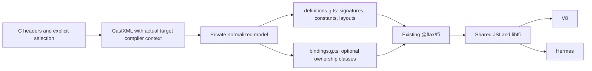

# FFI header code generation proposal

Status: historical design and feasibility evidence. The optional package and build
integration are now implemented; see the current [codegen contract](ffi-codegen.md). The
original experiment is in
[experiments/ffi_codegen](../../experiments/ffi_codegen/README.md).

## Recommendation

Reuse **CastXML as a build-time C header frontend** and implement a small TypeScript
emitter for the existing `@flax/ffi` API. Generate low-level definitions first; generate
resource classes only when the library author explicitly supplies ownership rules. Both
outputs use the existing V8/Hermes JSI/libffi path. No new engine API, Dart business
binding, or C parser is needed.

Keep the proposed `@flax/ffi-codegen` as an optional development dependency. An
application consumes generated JS/types and the optional `@flax/ffi` runtime. A library
author can generate files before publishing, so consumers need neither the generator nor
CastXML. This proposal does not authorize publishing either package.

## Frontend selection

| Candidate      | Evidence and fit                                                                                                                                                                                                                                  | Decision                                                                                                                                 |
| -------------- | ------------------------------------------------------------------------------------------------------------------------------------------------------------------------------------------------------------------------------------------------- | ---------------------------------------------------------------------------------------------------------------------------------------- |
| CastXML        | Its official macOS arm64 archive ran without a separate LLVM install. Versioned XML contains canonical types, function signatures, enum values, sizes, alignments and field offsets. Three Apple targets and a real SQLite header were exercised. | Use this frontend for the first implementation.                                                                                          |
| c2ffi          | Its current upstream branch targets LLVM 21.1. The local LLVM 22 probe first failed version resolution; forcing that toolchain exposed removed Clang C++ APIs. The supported LLVM 21 environment was not tested.                                  | A possible alternative, but maintaining a parser fork or local LLVM compatibility patches is unnecessary for this project.               |
| Dart ffigen    | A maintained LibClang frontend and Dart binding generator. It is already used for Flax's internal C ABI declarations; its documented output and generation API target Dart.                                                                       | Keep that existing use. Adding a Dart toolchain/AST adaptation solely to emit JS is less direct than the successful standalone frontend. |
| Clang AST JSON | The compiler is already present, but a replacement adapter would also need authoritative record layout extraction. Combining AST JSON with a separate text layout dump would introduce another parser boundary.                                   | No additional frontend implementation in the first version.                                                                              |

The tested CastXML archive is `v2026.01.30`, reporting `0.6.20260105-g9864b1e` with
Clang 21.1.8 and XML format 1.4.0. It is approximately 47 MB compressed and links only
to the system libc++ and libSystem on this host. This is evidence for this archive and
host, not a claim about all distributions.

The formal tool should pin the frontend artifact/version and SHA-256, cache it on first
use, and support an explicit tool path for offline builds. Do not run a native compiler
or download a tool from an application import. Preserve upstream notices when
distributing a tool bundle; macOS Intel, Windows and Linux hosts need their own tool
packaging and acceptance checks.

## Generation path and outputs

The XML and normalized model remain private build intermediates. Do not add another
public schema alongside the existing runtime signatures and native asset manifest.

`definitions.g.ts` preserves native symbol names and exports ordinary signature objects
with `arguments` and `return`, plus constants and necessary aggregate descriptors.
Native functions, callback signatures and global variable types are distinct exports.
Array parameters use their compiler-adjusted pointer type; fixed array fields retain
their length. Incomplete structs are valid behind pointers and invalid by value. Resolve
integer widths and enum storage through the target AST; do not infer `long` or `size_t`
from the development machine.

The common primitive subset follows Node's signature format. Emit no Flax runtime import
when a selected definitions module uses only that subset. C boolean semantics use Flax's
`c_bool`; Node's `bool` is an alias for numeric `uint8` and must not silently replace
it. Aggregates, explicit variadic contracts and resource finalizers remain Flax
extensions. A future Node-compatible selection must reject unsupported extensions rather
than silently degrade their signatures. Node FFI runtime execution is not part of this
experiment.

`bindings.g.ts` accepts an existing `DynamicLibrary` through `createBindings(library)`.
The caller can use `DynamicLibrary.codeAsset(id)`, `DynamicLibrary.process()` or a
deliberate dynamic library path. Generation does not guess a filename from `suffix`,
open a library during module import, or close a shared library from an individual
object's destructor. The returned low-level functions use the runtime's existing
signature cache; the generator does not create another cache.

The experiment also emits assertions checking each generated aggregate's runtime size,
alignment and offsets before resolving functions. These catch descriptor mistakes; they
cannot prove that an arbitrary prebuilt binary matches its header.

## Explicit semantics that headers cannot supply

Library authors provide a small generation recipe with headers, symbol selection,
compiler inputs and any resource mappings. The `Counter` recipe in this experiment is
deliberately restricted to one known shape, not a proposed general-purpose DSL.

| Information              | Automatic extraction                                | Author-supplied rule                                                                               |
| ------------------------ | --------------------------------------------------- | -------------------------------------------------------------------------------------------------- |
| Function/record/enum ABI | Types, parameter order, result type, storage layout | Symbol selection and optional availability                                                         |
| Opaque resource          | Pointer-shaped parameters and results               | Constructor, destructor, receiver argument, null failure rule and ownership transfer               |
| Strings and buffers      | Pointer and pointee types                           | Encoding, length, borrowed/owned status and native allocator/destructor pairing                    |
| Callback                 | Function pointer signature                          | Synchronous/listener/threadsafe mode, retention, unregister/stop contract and copied payload rules |
| Variadic function        | Fixed prefix and ellipsis                           | One explicit set of promoted extra argument types per binding                                      |

Do not infer ownership from `const`, a `create`/`free` spelling or a callback typedef.
Do not automatically move calls to a background thread. These choices depend on the
native library's contract and cannot be recovered reliably from an ordinary header.

Initially support C ABI exports. C++ classes, templates and non-C calling conventions
need explicit C wrappers. Static/inline declarations without exported symbols need
wrappers or deliberate exclusion. Report source locations and reasons for rejected
selected declarations; do not silently omit required functions. Explicitly selected
integer macros can be folded by Clang using a small wrapper translation unit. The probe
preserves a uint64 constant beyond JS's safe-number range as a bigint; it does not
implement a C expression evaluator or automatically convert function-like macros.

Bitfields, unsupported alignment, flexible-array mappings, long double and other
unrepresentable types must produce actionable diagnostics until supported by both the
emitter and runtime. A pointer to an otherwise unsupported type can remain an opaque
pointer; selecting that type by value must still fail.

## Generated resource class rules

Use one `NativeFinalizer` factory per binding class and one detach key per instance.
Keep the pointer private. The destructor used for GC must be a bound native
`void(pointer)` function, short, and independent of JavaScript. A fallible destructor or
a resource requiring ordered child shutdown needs an explicit library-specific
wrapper/cleanup policy; do not erase its return code or invent a GC policy.

1. Allocate, check the configured failure sentinel, then attach cleanup. If attachment
   fails, the constructor still owns the pointer and releases it once before throwing.
2. Manual `close()` first checks that the library is callable. Then detach successfully,
   clear the object's pointer and invoke the destructor once. A failed detach never
   authorizes manual release. Do not retry a destructor whose execution may have begun.
3. If the caller has already closed the library, manual close fails before detaching.
   The finalizer retains cleanup ownership; GC or Session close can still release it.
   This avoids orphaning an allocation by cancelling cleanup before a rejected call.
4. GC releases unreachable instances through the existing Session wakeup. Repeated
   collection cannot repeat cleanup. Session close cleans retained instances before
   destroying the runtime; application code must not call the closed Session afterward.
5. Do not generate escaping zero-copy views from an automatically finalized resource in
   the initial class emitter. Use copies or an explicit owner-retention contract. A
   bigint pointer and a byte view alone do not keep native memory alive.

The resource recipe must not generate a target-retaining closure as its finalizer. Keep
callbacks registered for exactly their configured native retention period. Header
codegen does not change the runtime's callback cancellation, Session retirement or
cleanup-error reporting contracts.

## Target profiles and build integration

The experiment demonstrates why architecture alone is insufficient: its `CgTargetValue`
is 8 bytes on macOS arm64, 2 on iOS device arm64 and 4 on iOS simulator arm64. An object
defined from the wrong SDK can have a valid pointer width and still call native code
with the wrong ABI.

For the first formal integration, select a target explicitly **before JS bundling**. The
JS build and native build must share the same target recipe. Include OS, architecture,
device/simulator, deployment target, SDK identity, language standard, ABI-affecting
flags/defines and include paths. CastXML should mirror the actual compiler's predefines
using `--castxml-cc-gnu-c`, together with its target and sysroot. This was exercised
with the real Apple compiler, not only a Clang target triple.

The current native build hook learns the final target from Flutter's code-assets
configuration after JS preparation. It does not yet transmit a complete codegen profile
to the JS build. Do not claim that the experiment adds automatic target selection or
this handshake. Extend the existing native plan with generation input fingerprints and
reject a mismatched Flutter target before compiling/linking. Do not start a recursive JS
build inside the Dart build hook.

Source libraries should use the same include paths and compiler definitions for
generation and compilation. CMake libraries can supply a selected compilation command;
prebuilt libraries need an explicit vendor header/ABI profile. Hash transitive header
dependencies, the selection/ownership recipe, target inputs and tool versions for
incremental regeneration. Stage outputs and replace them atomically after successful
generation; write unchanged files only when their content differs.

Native packaging stays with `flax.native` and `DynamicLibrary.codeAsset`. Codegen does
not add a second package manifest, alter iOS signing, promise per-function native dead
stripping, or require developers to install a public Dart FFI package. For the runtime
probe only, the tiny fixture archive is deliberately linked into Runner and opened
through `DynamicLibrary.process()`.

## Implementation order and acceptance

1. Package the proven frontend adapter as an optional Node development CLI. Generalize
   selection and names, pin the XML version/tool artifact, and keep unknown selected
   types as errors. Keep the existing internal Dart `ffi:generate` tool separate.
2. Add the explicit target recipe and native-hook mismatch check. Demonstrate a clean
   external consumer build for macOS and iOS Simulator, including incremental rebuilds
   when a transitive header or an ABI-affecting define changes.
3. Add ownership-driven classes and callback metadata only for declared recipes. Keep
   the tested constructor rollback, manual close, closed-library, automatic GC and
   Session-close cases. Test any additional cleanup failure policy before emitting it.

The experiment's maintained [results](../../experiments/ffi_codegen/results.json) record
the exact counts, tools, targets and binary identities. It validates feasibility of the
shared call path and a restricted class emitter. It is not a production CLI, automatic
build integration, a full C/C++ binding generator or cross-platform certification.

## Primary references

- [CastXML manual](https://github.com/CastXML/CastXML/blob/master/doc/manual/castxml.1.rst)
  and
  [official tool archive](https://github.com/CastXML/CastXMLSuperbuild/releases/tag/v2026.01.30).
- [c2ffi version requirements](https://github.com/rpav/c2ffi/tree/llvm-21.1.0).
- [Dart ffigen](https://pub.dev/packages/ffigen).
- [Node FFI signatures and types](https://nodejs.org/api/ffi.html).
